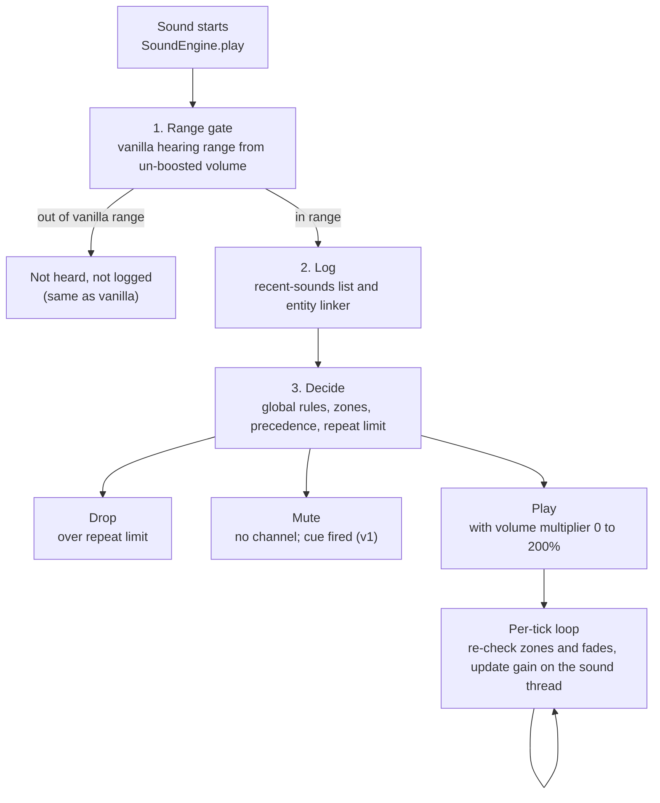

# Audio Zone PRD

Nov 8, 2026 · maxismagical, Sciencode

Audio Zone is a client-only Fabric mod that lets a player mute, turn down, boost or rate-limit any Minecraft sound, everywhere or only inside areas they draw, without ever hearing more than vanilla allows. This is draft 1 of the full PRD. Every requirement is tagged **MVP**, **v1** or **Future**, and every FR has in-game acceptance criteria.

## Draft status and working assumptions

maxismagical had not yet answered questions on scope, so this draft picks defaults. Each one is listed here and repeated in section 12. Change any of them and the affected sections will be revised.

| # | Assumption | Why this default | Sections affected |
| --- | --- | --- | --- |
| A1 | Initial build supports Minecraft Java 26.2 and 26.3 (decided by maxismagical). Java 26.x ships unobfuscated, so code uses Mojang's official names (e.g. `SoundEngine`, `SoundInstance`). | Matches the decided platform; Fabric dropped Yarn names after the de-obfuscation change. Verified at M0: `SoundEngine.play(SoundInstance)` and `calculateVolume` exist in both versions. | 7, 12 |
| A2 | MVP ships global rules, the recently played list, search, **basic fixed zones** (sphere and box, Inside mode, hard edge). | Zones are the product's namesake, so a first release without any zone would miss the main promise. | 5, 10 |
| A3 | Volume in MVP is 0–100%. Boost to 200% arrives in v1. | Boost needs the riskiest engine change (raising the gain clamp without raising range). | 5, 10 |
| A4 | Each server or world has exactly one profile, created automatically (MVP). Copying settings from another server and import/export are v1. | Fixed zones need a server/world key from day one; full profile management is a lot of UI. | 5, 10 |
| A5 | Distances in the recently played list are shown as coarse bands (Close, Near, Far), not exact block counts. | Exact distance to an unseen mob is more than vanilla subtitles give. See FR-1.4. | 5, 8 |
| A6 | Zone checks run when a sound starts, then every client tick (20 times a second) for sounds that are still playing. | Handles minecarts, entity-bound sounds and the moving personal bubble without per-frame cost. | 5, 7 |
| A7 | The default hotkey that opens Audio Zone is **;** (semicolon). | Free in vanilla and in the 36 most-downloaded Fabric mods (K clashed with Iris, checked at M0); rebindable in Controls. | 5 |
| A8 | English (en\_us) at launch, with every string in a language file ready for community translation. | Keeps launch small; localization is cheap to add later if planned now. | 9 |

## 1. Summary and problem statement

**Summary.** Audio Zone gives players per-sound control over what they hear: mute, volume from 0% to 200%, repeat limits, and visual cues when a muted sound plays. Rules can apply everywhere, or only inside (or outside) zones placed at fixed coordinates or around the player. It runs on the client only, so it works on vanilla servers, Realms and singleplayer.

**Problem.** Vanilla Minecraft offers only about ten volume sliders: Master plus one per sound category (Music, Jukebox/Note Blocks, Weather, Blocks, Hostile Creatures, Friendly Creatures, Players, Ambient/Environment, Voice, and others; checked at M0, 26.2 and 26.3 both have Master, Music, Jukebox/Note Blocks (`record`), Weather, Blocks, Hostile Creatures, Friendly Creatures (`neutral`), Players, Ambient/Environment, Voice/Speech and UI). A *category* is a broad bucket; a player cannot silence one sound (villager "hmm") without silencing every friendly mob. This causes three recurring pain points:

- **Noise in farms and bases.** Iron farms, villager trading halls, mob farms and redstone clocks produce hundreds of sounds per second. Players turn whole categories off and lose sounds they need, such as creeper hiss or a player's footsteps.
- **Sensory and hearing needs.** Players with sound sensitivity or sensory overload need specific harsh sounds removed (explosions, ghast screams, glass breaking). Players with hearing loss need some quiet sounds louder, which vanilla cannot do beyond 100%.
- **Location matters.** A sound that is fine in the wild is unbearable next to a farm. Players want "quiet near my farm, normal everywhere else".

Existing sound mods are mostly category sliders or global mute lists, and few address the fair-play question. Audio Zone's difference is **per-sound + per-place control with a strict no-information-advantage guarantee**, so it can be allowed on servers that ban cheat or "info" mods.

Terms used here (*sound event*, *sound instance*, *category*, *client-only*, *Fabric*, *Mixin*) are explained in the Glossary (section 13).

## 2. Target users and personas

Five personas drive the requirements. The accessibility persona is a first-class persona: when trade-offs conflict, their needs win over convenience features.

| Persona | Who they are | What they need from Audio Zone | Key FRs |
| --- | --- | --- | --- |
| **Tess, technical/farm player** | Runs iron farms, villager halls and redstone builds on a survival SMP. | Silence or rate-limit farm noise only near the farm; keep danger sounds. No FPS loss with 300+ sounds per second. | FR-1, FR-4, FR-6, FR-8, FR-9 |
| **Sam, streamer/recorder** | Records or streams gameplay; viewers complain about repetitive noise. | Per-sound volume for a clean mix; settings that follow each server automatically; stable behavior on stream. | FR-5, FR-11, FR-12 |
| **Alex, accessibility needs** | Has sound sensitivity (misophonia or sensory overload) or partial hearing loss; may use a screen reader or keyboard only. | Remove specific harsh sounds; boost quiet ones up to 200%; still *know* a muted sound happened via cues; every screen usable by keyboard and narrator. | FR-5, FR-7, FR-13 (all UI), section 6.4 |
| **Bea, builder** | Builds for hours in creative or on a build server. | A personal bubble that quiets ambient and mob noise around them wherever they go; zone outlines that don't clutter the view. | FR-8, FR-10 |
| **Mo, multiplayer regular** | Plays on several servers, some with strict mod rules. | Settings that follow each server automatically; a clear statement that the mod gives no advantage, so admins allow it. | FR-11, section 8 |

## 3. Goals, non-goals and success metrics

### 3.1 Goals

- **G1. Per-sound control.** Any sound event, including sounds from other mods and resource packs, can be muted, set from 0% to 200%, or rate-limited.
- **G2. Per-place control.** The same controls apply inside or outside zones at fixed coordinates or around the player.
- **G3. Find any sound in under 30 seconds.** A player who just heard a sound can find and mute it from the recently played list without knowing its ID.
- **G4. Accessible by default.** Every feature works with keyboard only, at every GUI scale, with narrator support where vanilla has it, and never relies on color alone.
- **G5. Fair play.** No feature gives information beyond vanilla audio and subtitles (the core principle).
- **G6. Invisible cost.** No measurable FPS loss in normal play; under 1 ms of added work per frame in a 300-sounds-per-second stress test.
- **G7. Maintainable across versions.** Version-specific code is isolated so a Minecraft update touches a small, known set of files.

### 3.2 Non-goals

- **No information advantage over vanilla.** Audio Zone never reveals a sound, entity, position or direction the player could not already hear or see in vanilla at vanilla range. This is a hard rule, not a preference.
- No server-side component in 1.0, and no features that need one (e.g. syncing zones between players). A companion server policy mod is a Future idea (section 10.3).
- No NeoForge, Forge or Quilt-specific builds. Quilt may load Fabric mods but is not tested.
- No sound replacement, pitch editing, equalizer, reverb or audio effects.
- No change to any sound's hearing range (the distance at which it can be heard at all). Loudness can go down or up; range never goes up.
- No dependency on a config library (Cloth Config, YACL, owo-lib). Screens are built from scratch.
- No Bedrock Edition support. No controls for vanilla-covered sounds that already have their own slider, such as background music and UI clicks (see section 5).

### 3.3 Success metrics

| Metric | Target | How measured |
| --- | --- | --- |
| Adoption | 5,000 combined downloads on Modrinth and CurseForge within 3 months of v1 | Platform dashboards |
| Stability | Fewer than 1 confirmed crash report per 1,000 downloads per release | GitHub issues labeled `crash` |
| Fair play | 0 confirmed reports of the mod revealing information beyond vanilla | Issues labeled `fair-play`; each is triaged within 7 days |
| Performance | Hot-path cost under 5 microseconds per sound on average; under 1 ms per frame at 300 sounds/second | Built-in diagnostics readout (FR-13) during the noisy-farm test |
| Findability | A new tester mutes a named sound from the recently played list in under 30 seconds, in 4 of 5 attempts | Moderated test with 5 players before v1 |
| Accessibility | All 6 core tasks (section 6.4) completed keyboard-only by a tester | Pre-release accessibility checklist |
| Server acceptance | At least 3 servers with client-mod allowlists add Audio Zone within 6 months | Self-reported, tracked in the README |
| Version freshness | A compatible Audio Zone release within 7 days of each official Minecraft release | Release dates on Modrinth vs Mojang's release date |

## 4. User stories and use cases

Each story maps to the FRs that satisfy it. Release tags show when the story first works end to end.

| ID | As a… | I want to… | So that… | FRs | Release |
| --- | --- | --- | --- | --- | --- |
| US-1 | farm player | open a list of sounds I just heard and mute one with one click | I can silence a sound without knowing its ID | FR-1, FR-5 | MVP |
| US-2 | farm player | mute all villager sounds only within 24 blocks of my trading hall | the hall is quiet but villagers elsewhere still sound normal | FR-8, FR-9 | MVP |
| US-3 | farm player | cap villager "hmm" sounds to 3 per second | the hall is calmer without going silent | FR-6 | v1 |
| US-4 | player with hearing loss | boost quiet sounds like footsteps to 180% | I can hear them at all | FR-5 | v1 |
| US-5 | player with sound sensitivity | mute explosions and still see a cue saying one happened | I stay safe without the shock | FR-5, FR-7 | v1 |
| US-6 | builder | have a 16-block bubble around me that sets all ambient and mob sounds to 30% | my build sessions are calm wherever I fly | FR-8 | v1 |
| US-7 | player | look at a mob and see the sounds it just made | I can mute the parrot that keeps imitating, without searching | FR-2 | v1 |
| US-8 | player | search "villager\|zombie" and see all matching sound IDs | I can mute a family of sounds at once | FR-3, FR-4 | MVP (plain/AND/OR), Future (regex) |
| US-9 | multiplayer regular | have my settings switch automatically when I join each server | I don't redo setup every session | FR-11 | MVP |
| US-10 | streamer | export my profile and send it to a friend | they get the same mix (fixed zones included if they play on the same server) | FR-11 | v1 |
| US-11 | keyboard-only or narrator user | reach and change every control without a mouse | the mod is usable for me | FR-12, 6.4 | MVP |
| US-12 | player | turn all Audio Zone effects off with one key | I can compare with vanilla or recover from a bad rule | FR-13 | MVP |
| US-13 | server admin | read a clear fair-play statement | I can decide to allow the mod | section 8 | MVP |
| US-14 | player | see every rule and zone that affected a sound and which one won | I can fix a setup that isn't doing what I expect | FR-14 | MVP |

**Example flow (US-1 + US-5; the cue part works from v1).** Alex hears a loud glass-breaking sound. They press **;**, the Recently Played tab is already open, and the top row reads "Glass breaks · minecraft:block.glass.break · Blocks · ×2 · Near". They press the Mute button on that row and tick "Show cue". The next time glass breaks, no sound plays and a cue reads "(muted) Glass breaks" in the subtitle area.

## 5. Functional requirements

Fourteen functional requirement groups, FR-1 to FR-14. Each has numbered sub-requirements, a release tag, a **Fair play** statement explaining how it follows the core principle, and acceptance criteria (AC) written as in-game checks. Tick the AC boxes as you test.

Two definitions are used throughout:

- **Vanilla hearing range** of a sound = `max(vanilla volume, 1.0) × attenuation distance` (attenuation distance is 16 blocks for almost every sound). This is the distance vanilla itself uses to decide whether to notify subtitles. It is always computed from the *un-modified* vanilla volume, never from Audio Zone's volume. Verify the exact formula against 26.2 at M1.
- **Positional sound** = a sound instance with linear attenuation that is not relative to the listener. Everything else (music, UI clicks, most sounds attached to the player's own head) is **non-positional**.

**Vanilla-covered sounds are out of scope.** A sound is *vanilla-covered* when a vanilla slider already controls that kind of sound and nothing else. Background and menu music (Music slider) and interface sounds such as button clicks (UI slider; 26.2 and 26.3 both have one) and the Voice/Speech slider's sounds are the excluded set. Audio Zone leaves these sounds untouched. They do not appear in the recently played list, the entity inspector or search, no rule or zone pattern matches them (not even `*`), and they produce no cues. Sounds in a broad category that holds many different sounds stay in scope. Jukebox records and note blocks are one example (shared slider). Mobs, blocks and weather are others. Checked at M1: 26.2 and 26.3 both have separate Music, UI and Voice/Speech categories (see Q8).

How the check works: a sound is excluded by the category it plays in (Music, UI, Voice/Speech). Search cannot know a sound's category in advance, so it hides IDs under `minecraft:music.*` and `minecraft:ui.*`, plus any modded ID that has already played in an excluded category this session.

### FR-1 Recently played sounds list (MVP)

The main entry point: a live list of sounds the player just heard, with one-click actions.

- **FR-1.1** Audio Zone records every sound the client starts or would have started (including sounds Audio Zone muted or limited) **if** it is non-positional, or it is positional and the listener is within its vanilla hearing range at the moment it starts. Vanilla-covered sounds (Music, UI, Voice/Speech) are never recorded.
- **FR-1.2** Rows are grouped by sound ID. Each row shows: subtitle text (or the ID if the sound has no subtitle), full ID, category, play count in the last 3 minutes, time since last play ("2s ago"), distance band (FR-1.4), and a status label: Playing, Muted, Limited, Boosted, or "Zone: \<name>". Status uses text and an icon, never color alone.
- **FR-1.3** The list keeps the last 3 minutes, up to 200 distinct IDs. Sort by most recent (default), play count, or name. A Pause toggle (key **P** while the list is focused) freezes the list for reading.
- **FR-1.4** Distance is shown as a band, not a number: **Close** (4 blocks or less), **Near** (4 to 16), **Far** (more than 16, only possible for loud sounds). No direction and no coordinates are shown. Non-positional sounds show "Around you".
- **FR-1.5** Each row has quick actions: Mute/Unmute, Volume (opens a slider pop-up), Limit (opens count and window fields, v1), Cue on/off (v1), and "Edit rule…". An "Apply to" selector chooses Everywhere (global rule) or one of the zones the player is standing in. Quick actions create or edit an exact-ID rule. "Make pattern…" offers a suggested wildcard, e.g. `minecraft:entity.villager.*`.
- **FR-1.6** The list refreshes at most 4 times per second. The Recently Played tab does not pause a singleplayer game, so sounds keep arriving while it is open.

**Fair play.** Only sounds the player was in vanilla range to hear are listed, which is the same set vanilla subtitles would show. Distance bands are coarser than the loudness the player hears; no direction or position is shown. Risk flag: some strict servers may still object to any distance hint. Setting "Show distance" (default on) hides the column entirely.

**Acceptance criteria**

- [ ] Stand near a villager; within 5 seconds of it making a sound, a row "minecraft:entity.villager.ambient" (or similar) appears with category Friendly Creatures and band Close or Near.
- [ ] Walk 30 blocks from all villagers and wait 10 seconds: no new villager rows appear and existing counts stop increasing.
- [ ] Click Mute on a row: the next play of that sound is silent and the row status changes to "Muted".
- [ ] With the list open in singleplayer, the world keeps running (mobs move, sounds keep arriving).
- [ ] Toggle "Show distance" off: the distance column disappears.
- [ ] With 300 sounds per second (noisy-farm test), FPS with the list open is within 5% of FPS with it closed.

### FR-2 Point-at-entity sound inspector (v1)

Look at a mob or other entity and see the sounds it recently made, with the same quick actions as FR-1.

- **FR-2.1** Pressing the Inspect key (default unbound; also a button on the main screen) selects the entity under the crosshair. Selection uses a line-of-sight ray up to 32 blocks that stops at solid blocks. Entities invisible to the player in vanilla are never selected.
- **FR-2.2** For each entity within vanilla hearing range, Audio Zone remembers its last 20 sounds from the last 30 seconds (at most 256 entities tracked).
- **FR-2.3** Sounds are linked to entities in two ways, and each link is labeled:
  - **Linked** (certain): the sound instance itself is attached to the entity, or the server sent it as an entity sound with the entity's ID.
  - **Likely** (guessed): a plain positional sound that started within 1.0 block of the entity's position on that tick. Candidates whose type matches the sound ID (`entity.villager.*` and `minecraft:villager`) are preferred. If two candidates are within 0.25 blocks of each other, the link is marked "Uncertain".
- **FR-2.4** If no sounds are linked to the entity, the inspector says "No sounds linked yet" and shows nothing else. There is no fallback list; the recently played tab covers unlinked sounds.
- **FR-2.5** Accuracy target: in the 10-villager pen test (section 11), at least 90% of Likely links are correct and 0 links point to an entity outside vanilla hearing range.

**Fair play.** Only an entity the player can see, through clear line of sight, can be inspected, and only sounds the player could hear are shown. The inspector never highlights or lists entities behind walls. It adds a name to a sound the player heard from a mob they are looking at, which vanilla subtitles already do ("Villager mumbles").

**Acceptance criteria**

- [ ] Look at a villager 10 blocks away and press Inspect: its recent sounds appear, each labeled Linked, Likely or Uncertain.
- [ ] Look at a villager behind a glass-free stone wall: nothing is selected.
- [ ] Look at a minecart moving on rails: its rolling sound is labeled Linked.
- [ ] Look at a mob that made no sound: the panel shows "No sounds linked yet" and no other sounds.
- [ ] Pen test: at least 18 of 20 sampled Likely links name the right villager.

### FR-3 Sound search (MVP: plain text, AND, OR; Future: regex)

Browse every sound the game knows by name or ID.

- **FR-3.1** The search covers every sound ID the client knows: the sound event registry plus every ID defined in `sounds.json` files of loaded resource packs and mods. The list is rebuilt after a resource reload (F3+T). Vanilla-covered sounds are hidden.
- **FR-3.2** Each result shows ID, subtitle text in the current language (if any), and "Seen as: \<category>" if the sound has played this session. (A sound event has no fixed category; the code that plays it picks one.)
- **FR-3.3** Results have the same quick actions as FR-1, plus Preview (Future, after 1.0), which plays the sound once at the player's own position at 100%.
- **FR-3.4** Results update 150 ms after the player stops typing and show a count ("42 sounds").
- **FR-3.5** The exact syntax is below. A help panel on the search screen shows the table's examples. Matching is case-insensitive and looks at both the ID and the subtitle text, except regex, which looks at the ID only.

| You type | It means | Example matches |
| --- | --- | --- |
| `villager` | contains "villager" | `minecraft:entity.villager.ambient` |
| `villager hurt` | contains **all** words (AND) | `minecraft:entity.villager.hurt` |
| `villager\|zombie` | contains **either** (OR) | villager and zombie sounds |
| `villager hurt \| zombie hurt` | `\|` splits into groups first; spaces inside a group mean AND | hurt sounds of villagers or zombies |
| `-ambient` | must **not** contain "ambient" | combine: `villager -ambient` |
| `"glass break"` | exact phrase, spaces included | subtitle "Glass breaks" (contains the phrase); not "break glass" |
| `block.*.step` | `*` = any characters | `minecraft:block.stone.step` |
| `/entity\.(cow\|pig)\..*/` | regex between slashes (Future), ID only, max 100 characters | cow and pig sounds |

- **FR-3.6** (Future) An invalid regex shows a message under the field in plain words ("Missing closing bracket") and keeps the previous results. A regex that takes longer than 50 ms over all IDs is stopped and reported as "too complex".

**Fair play.** Search lists sound IDs, which are public game data. It shows nothing about the world.

**Acceptance criteria**

- [ ] Type `villager`: only villager-related sounds appear, with a count.
- [ ] Type `villager|zombie`: both families appear; `villager zombie` returns none (no ID contains both).
- [ ] Type `villager -ambient`: no result contains "ambient".
- [ ] Install a resource pack that adds a new sound in `sounds.json`, press F3+T, search its name: it appears.
- [ ] (v1) Type `/entity\.(cow|pig)\..*/`: only cow and pig sounds; type `/(/`: a readable error appears and the game does not freeze.
- [ ] Every control on the screen can be reached and used with Tab, arrows and Enter.

### FR-4 Wildcard rule patterns (MVP)

A rule targets sound IDs through a pattern, so one rule can cover a family of sounds, including sounds from other mods.

- **FR-4.1** Pattern format: `namespace:path`, where `*` matches any run of characters, including none and including dots. No other special characters. A pattern with no `:` matches any namespace: `block.*.step` is the same as `*:block.*.step`. A pattern must match the whole ID, so `villager` alone matches nothing; use `*villager*`.
- **FR-4.2** Allowed characters: `a-z 0-9 _ . - / : *`. Uppercase is converted to lowercase. Anything else shows an inline error and blocks Save.
- **FR-4.3** While editing, a live preview shows "Matches N sounds" with an expandable list, from the same ID set as FR-3.1.
- **FR-4.4** Patterns match against the ID of each sound as it plays, so sounds added later by mods or resource packs match without a restart. Vanilla-covered sounds never match.
- **FR-4.5** When several rules in the same list (the global list, or one zone's list) match a sound, they are resolved **per property**: loudness (mute and volume together, so a rule that sets either one competes for both), limit, and cue. For each property, the most specific matching rule that sets it wins:
  1. An exact ID (no `*`) beats any pattern.
  2. More literal (non-`*`) characters beat fewer.
  3. Fewer `*` beat more.
  4. A rule higher in the list beats a lower one.
- **FR-4.6** The rule editor shows "Partly overridden by: \<rule>" when a more specific rule takes over one of this rule's properties.
- **FR-4.7** A rule can be disabled without deleting it.

**Fair play.** Patterns only choose which sounds a rule changes.

**Acceptance criteria**

- [ ] Rule `minecraft:entity.villager.*` set to Mute: all villager sounds are silent; wandering trader sounds are not.
- [ ] Rule `*:block.*.step` set to 50%: footsteps on stone, wood and a modded block are all quieter.
- [ ] Add rule `minecraft:entity.villager.ambient` at 100% below the mute rule above: villager ambient sounds play; other villager sounds stay muted; the wildcard rule shows "Partly overridden by…".
- [ ] Type `Minecraft:Entity.Cow.*`: it becomes lowercase. Type `entity.cow.#`: error shown and Save disabled.
- [ ] Disable a rule: its effect stops immediately; enable it: the effect returns.

### FR-5 Mute and volume, 0–200% (MVP: mute and 0–100%; v1: boost to 200%)

- **FR-5.1 (MVP)** Mute: the sound produces no audio. Mute is separate from the volume value, so unmuting restores the previous volume.
- **FR-5.2 (MVP)** Volume per rule from 0% to 100%. The slider moves in 5% steps; arrow keys ±5%, Shift+arrow ±1%; the number can be typed directly.
- **FR-5.3 (MVP)** Final loudness = vanilla loudness (including the Master and category sliders) × rule volume. Master at 0% still silences everything.
- **FR-5.4 (v1)** Boost: volume from 101% to 200%. Above 100%, the slider shows a warning icon and the text "May distort. Protect your hearing." The first time a profile goes above 100%, a dialog explains clipping and hearing safety and needs a confirm. The narrator reads the warning.
- **FR-5.5 (v1)** Boost changes loudness only. The vanilla hearing range, every range check (subtitles, cues, recently played list) and the distance fade-off curve are calculated from the un-boosted vanilla volume. At the edge of vanilla range a boosted sound is silent, exactly as in vanilla.
- **FR-5.6 (v1)** Final gain is capped at 2.0 (200% of vanilla full volume), however the multipliers combine.

**Fair play.** Mute and turn-down only remove information. Boost makes a sound louder only where it is already audible in vanilla; the AC below prove the range does not grow.

**Acceptance criteria**

- [ ] Mute `minecraft:entity.cow.ambient`: cows are silent; unmute: they return at the earlier volume.
- [ ] Set cows to 25%: cows are clearly quieter than sheep at the same distance.
- [ ] Set Master to 0%: nothing plays, even with a 200% rule.
- [ ] (v1) Set a rule to 150%: the warning text and icon appear; the confirm dialog appears once per profile.
- [ ] (v1) **Boost-range test** (section 11.3): with villagers at 200%, the farthest distance at which a villager is audible is the same as with the mod bypassed (within 1 block).
- [ ] (v1) With villagers at 200%, the recently played list and cues stop listing villager sounds at the same distance as with 100%.

### FR-6 Repeat limiting (v1)

Cap how often a sound or group can play, e.g. "at most 3 villager 'hmm' sounds per second". Plays over the cap are dropped.

- **FR-6.1** A rule's limit has a count N (1 to 100) and a window W (50 ms to 10 s, default 1 s).
- **FR-6.2** **Sliding window.** A new play is allowed if fewer than N plays counted by the same counter started in the last W milliseconds. Otherwise it is dropped. Time is real time, not game ticks, so lag does not change the cap.
- **FR-6.3** Only allowed plays are counted. Dropped plays do not count, so a steady stream settles at exactly N per window instead of going silent.
- **FR-6.4** **Shared count (default):** one counter per rule covers every sound the rule matches (all villagers together).
- **FR-6.5** **Per-source option:** one counter per source position, rounded down to the block the sound starts in. Two villagers in different blocks count separately. Each rule tracks up to 1,024 positions; the least recently used is forgotten first.
- **FR-6.6** Looping and long sounds count once, when they start. A sound that is already playing is never cut off by a limit.
- **FR-6.7** When a global rule and a zone rule both set a limit for a sound, only the winning rule's limit applies (FR-9). Each rule has its own counter, which only counts sounds that rule actually decided. A fade zone's limit applies only where the zone's fade weight is 0.5 or more.
- **FR-6.8** Dropped plays show as "Limited" (with a dropped count) in the recently played list and never produce a cue.

**Fair play.** Limiting only removes sounds.

**Acceptance criteria**

- [ ] 20 villagers in a pen, rule `minecraft:entity.villager.ambient` limited to 3 per 1 s (shared): over 30 seconds the list shows about 90 played and the rest Limited, never more than 3 starting in any one second (diagnostics readout).
- [ ] Same with Per source on: each villager can be heard independently; total plays rise.
- [ ] Limit minecart sounds to 1 per 10 s, start two minecarts 2 seconds apart: the first keeps rolling audibly; the second is silent.
- [ ] Global limit 5/s and a zone limit 1/s on the same sound: inside the zone, at most 1 per second plays.

### FR-7 Cues for muted sounds (v1)

When a muted sound plays, the player still sees that it happened.

- **FR-7.1** A cue appears when a sound's final volume is 0 because of an Audio Zone rule (mute, 0%, or a fully faded zone), the deciding rule has Cue on, and the sound passes the same range check vanilla uses for subtitles.
- **FR-7.2** Cue text is the sound's vanilla subtitle. Sounds without a subtitle show no cue, unless the setting "Cue sounds without subtitles" is on (default off), which shows the sound ID instead.
- **FR-7.3** Cues are drawn in their own box directly above the vanilla subtitle box (bottom right), whether vanilla subtitles are on or off. Each line starts with the text "(muted)" and a muted-speaker icon, is drawn in italics, and uses a different text color (default light blue-gray, configurable). The prefix makes the difference clear without color.
- **FR-7.4** Direction is shown exactly as vanilla subtitles do (`<` or `>` when the source is to the side), nothing more. Lines fade out after 3 seconds, like vanilla.
- **FR-7.5** At most 5 cue lines. Repeats of the same subtitle merge into one line with a count ("(muted) Villager mumbles ×4").
- **FR-7.6** New mute rules have Cue on by default. The default can be changed in Settings.
- **FR-7.7 Master switch.** Settings has "Show muted-sound cues", on by default. When off, no cues show at all, whatever each rule's Cue toggle says. When on, each rule's Cue toggle decides. The switch does not depend on vanilla's Subtitles option. It is also available as an optional hotkey (unbound by default).

**Fair play.** A cue shows only what the vanilla subtitle for the same sound would have shown, for sounds within vanilla range, with the same left/right arrow and no distance.

**Acceptance criteria**

- [ ] Mute `minecraft:entity.generic.explode` with Cue on, light TNT 10 blocks away: no sound; "(muted) Explosion" appears with the same arrow vanilla subtitles show.
- [ ] Turn Cue off on that rule: the next explosion shows nothing.
- [ ] Mute villagers, walk 25 blocks away: no villager cues appear.
- [ ] Turn vanilla subtitles on: a normal subtitle and a muted cue are both visible and clearly different without relying on color (screenshot in grayscale still distinguishes them).
- [ ] 10 muted villagers at once: no more than 5 cue lines, with counts.
- [ ] Turn "Show muted-sound cues" off: a muted explosion with Cue on shows nothing. Turn it back on: the cue returns. Vanilla Subtitles on or off makes no difference either way.

### FR-8 Spatial zones (MVP: fixed sphere and box, Inside, hard edge; v1: the rest)

A zone applies its own rules (mute, volume, limit, cue) to positional sounds based on where they come from.

- **FR-8.1 Fixed anchor (MVP).** A point (x, y, z) plus the dimension (e.g. `minecraft:overworld`) and the world key of the server or singleplayer world (FR-11.1). Buttons: "Set to my position" and "Set to the block I'm looking at". A fixed zone is active only in its own world and dimension.
- **FR-8.2 Personal bubble (v1).** The anchor is the local player's eye position, updated every tick. A profile can have several bubble zones (e.g. a small mute bubble inside a larger 50% bubble). A bubble never follows another player.
- **FR-8.3 Shapes.** Sphere (radius 1 to 256 blocks) and axis-aligned box (width, height, depth 1 to 512) in MVP; vertical cylinder (radius 1 to 256, height 1 to 512) in v1. The anchor is the shape's geometric center for all three, so a box or cylinder extends half its size in each direction from the anchor.
- **FR-8.4 Affect mode.** Inside (default, MVP): the zone affects sounds inside its shape. Outside (v1): it affects every sound outside its shape in the same dimension.
- **FR-8.5 Edge (v1 fade; MVP hard).** Hard: weight 1 on the affected side, 0 on the other. Fade: the weight rises from 0 at the boundary to 1 at fade distance F into the affected side (F from 0.5 to 32 blocks, default 4). For Inside zones, F is measured inward from the boundary; for Outside zones, outward. Each zone uses the global default edge setting unless set to Hard or Fade itself.
- **FR-8.6 Zone rules.** Each zone has a rule list in the same format as the global list (FR-4). Pattern `*` means "every positional sound".
- **FR-8.7 Which sounds.** Only positional sounds are affected. The sound's position is the sound instance's x, y, z.
- **FR-8.8 Timing.** Zones are evaluated when a sound starts, and again every client tick (20 per second) for every sound still playing, so moving sources, long sounds and the moving bubble update. Re-evaluation changes volume only (including mute, which sets volume to 0 without stopping the sound). Repeat limits are decided at start only.
- **FR-8.9 Size limits.** Up to 64 zones per profile; performance budgets (section 9) must hold at 64.

**Fair play.** Zones change loudness of sounds the client already plays in vanilla range. They never make a sound audible that vanilla would not play, and fixed zones are the player's own data.

**Acceptance criteria**

- [ ] Create a 10-block sphere around a villager pen with rule `*villager*` Mute: villagers inside are silent; a villager 15 blocks from the anchor (outside) is audible.
- [ ] Leave and rejoin the world: the zone still exists and works. Go to the Nether: it has no effect there.
- [ ] Join a different server: the zone does not apply.
- [ ] (v1) Bubble radius 8, rule `*` at 30%: mobs within 8 blocks of you are quieter; as you walk away, a still-playing note block loop changes volume within half a second.
- [ ] (v1) Outside-mode sphere radius 20 around your base, rule `*:entity.*` Mute: mobs inside the base are audible, mobs outside are silent.
- [ ] (v1) Fade 8 blocks on a 20-block sphere muting cows: walking a cow from the edge toward the center, it gets steadily quieter and is silent from 8 blocks inside.
- [ ] Music, UI clicks and your own eating sounds are unchanged inside every zone.

### FR-9 Precedence (MVP basic; v1 with fade and Outside)

When global rules and one or more zones all have something to say about a sound, this algorithm decides the result. It runs per property: mute/volume, limit, and cue are decided separately.

1. **Global value.** Resolve the global rule list for this sound ID by specificity (FR-4.5).
2. **Affecting zones.** Collect zones in the current world and dimension whose weight w for this sound is above 0 (Inside: sound in shape; Outside: sound not in shape; fade per FR-8.5).
3. **Zone values.** Resolve each affecting zone's own rule list by specificity. A zone takes part for a property only if one of its rules sets that property.
4. **Winner per property.** Among zones that set the property, the winner is the zone whose anchor (center) is closest to the sound's position, measured as straight 3D distance. Outside zones are measured the same way, from their center, so a nearby Inside zone usually beats a broad Outside zone.
5. **Ties.** If two anchors are within 0.01 blocks of the same distance, the zone with the smaller shape volume wins; if still tied, the zone higher in the zone list wins.
6. **Blend.** Volume (mute counts as 0%): result = global value + (winner's value − global value) × w. Limit and cue: the winner's value applies if w is 0.5 or more, otherwise the global value.
7. **Defaults.** A property no rule sets keeps vanilla behavior (100%, no limit, cue off).

Data sketch (pseudocode, not implementation):

```
resolve(sound):
  g = globalRules.bestPerProperty(sound.id)
  zones = activeZones.where(z => z.weight(sound.pos) > 0)
  for prop in [volume, limit, cue]:
    setters = zones.where(z => z.rules.bestPerProperty(sound.id).has(prop))
    if none: result[prop] = g[prop] ?? vanilla
    else: w = winner(setters by anchorDistance, then smaller volume, then list order)
          result[prop] = blend(g[prop] ?? vanilla, w.value[prop], w.weight)
```

Worked examples (also the basis of the test matrix in section 11.4):

| Case | Global | Zones affecting the sound | Result |
| --- | --- | --- | --- |
| P1 | Villagers muted | Zone A (Inside, hard) villagers 50% | 50% inside A; muted outside A |
| P2 | Villagers muted | none | Muted |
| P3 | nothing | A villagers 20%, anchor 3 blocks away; B villagers 80%, anchor 9 blocks away | 20% (A is closer) |
| P4 | nothing | A mutes villagers; B limits villagers to 2/s | Muted (from A) and limit 2/s (from B): properties combine |
| P4b | nothing | A sets villagers to 40%; B limits villagers to 2/s | At most 2 villager sounds per second, each at 40%: both properties apply together |
| P5 | nothing | A 20% and B 80%, both anchors 5.00 blocks away, A smaller | 20% (smaller zone wins the tie) |
| P6 | Cows 100% | A (Inside, fade 4) cows Mute; sound 2 blocks inside the edge, w = 0.5 | 50% |
| P7 | nothing | Outside zone O around base mutes `*`, anchor 40 blocks away; Inside zone A sets 70%, anchor 6 blocks away; sound is in both | 70% (A is closer) |
| P8 | Villagers 150% | A sets cue on only | 150% with cue setting from A (no cue shows, as the sound is not muted) |

**Fair play.** Precedence only chooses between the player's own settings.

**Acceptance criteria**

- [ ] Each case P1 to P8 behaves as in the table when built in a test world (section 11.4).
- [ ] Swapping two zones' order in the list changes the result only in the tie case P5 variant where sizes are equal.
- [ ] The recently played row for a sound shows which zone decided it ("Zone: A").

### FR-10 Zone visualization and colors (MVP outlines; v1 full)

- **FR-10.1** Setting "Show zone outlines": Always, Only while editing (default), or Never. Optional hotkey to toggle (unbound by default).
- **FR-10.2** Outlines are thin lines: box edges; sphere as three great circles; cylinder as top and bottom circles plus four vertical lines. Only zones in the current dimension within 128 blocks are drawn. A bubble outline is drawn only while that zone is being edited.
- **FR-10.3** Not color alone: Inside zones use solid lines and Outside zones dashed lines; a fade zone also draws a fainter inner line where the fade reaches full strength; the zone's name is shown as a label at its anchor when the player is within 32 blocks.
- **FR-10.4** Each zone has a color. New zones take the next color from a color-blind-safe palette (the 8 Okabe–Ito colors, chosen to stay distinct for the common forms of color blindness). The color picker offers the palette swatches, a hex field (e.g. `#E69F00`) with validation, and Reset to default.
- **FR-10.5** Setting "Outlines visible through blocks" (default on). This is safe because zones are the player's own data.
- **FR-10.6** Drawing all outlines and fills costs less than 0.3 ms per frame with 64 zones (diagnostics readout).
- **FR-10.7 Filled zones (Future, after 1.0).** Each zone has a Display setting: **Outline** (default, MVP), **Fill**, or **Both**, with a global default for new zones. Fill draws the zone's volume as a see-through tint in the zone's color.
  - Fill opacity is a slider from 5% to 50%, default 15%, per zone, so the tint never hides blocks or mobs.
  - When the camera is inside a filled zone, the fill fades out over 2 blocks from the boundary so the screen is not tinted. Setting "Show fill from inside" (default off) instead draws only the inner walls at half the opacity.
  - Where zones overlap, tints blend. Zone names and line styles (FR-10.3) stay visible, so overlaps never rely on color alone.
  - Fill follows the same visibility rules as outlines (FR-10.1, FR-10.2, FR-10.5) and the same frame budget (FR-10.6).
  - Risk flag: translucent rendering is the part most likely to break with Iris shader packs or a Minecraft render update. Fallback: if fill cannot render correctly, Fill and Both behave like Outline and the zone editor says why.

**Fair play.** Outlines show only zones the player created; no world information is revealed.

**Acceptance criteria**

- [ ] Set outlines to Always: each nearby zone is drawn in its color with its name label.
- [ ] An Outside zone's lines are dashed; an Inside zone's are solid.
- [ ] Change a zone color by swatch and by hex `#56B4E9`; typing `#XYZ` shows an error.
- [ ] Outlines render correctly with Sodium installed, and with Iris plus one popular shader pack (or a known-issue note is filed).
- [ ] (Future) Set a sphere zone to Fill at 15%: the sphere shows as a light tint in its color; blocks and mobs inside are clearly visible.
- [ ] (Future) Walk into the filled zone: the tint fades out as you cross the edge; walk out: it returns.
- [ ] (v1) Set opacity to 50% and to 5%: the tint gets stronger and weaker; typing 70 is refused with an error.
- [ ] (Future) Two overlapping filled zones: both names and line styles are still readable.
- [ ] (Future) With Iris and a shader pack, Fill either renders correctly or falls back to Outline with a message in the zone editor.

### FR-11 Server profiles and file import/export (MVP: one profile per server; v1: copy and files)

Each multiplayer server, Realm and singleplayer world has exactly one *profile*: its global rules, zones (fixed and personal bubble), and profile settings (cue defaults, outline mode, default edge, show distance). Profiles are never shared or switched between servers. Keybinds and UI preferences are app-wide, not per profile.

- **FR-11.1 Auto-create (MVP).** On joining, Audio Zone works out a world key: multiplayer = server address in lowercase with the default port 25565 removed (`play.example.net`); Realms = `realms:<realm id>`; singleplayer = `world:<ID from audiozone_id.txt>`. For singleplayer, Audio Zone writes a small file, audiozone\_id.txt, into the world's save folder on first join and uses the ID in it, so the profile survives folder renames and backups. If the file cannot be written (e.g. a read-only save), it falls back to the folder name and the Profiles tab says so. A copied world shares the original's ID, and so its profile, until the player clicks "Give this copy its own profile". If that key has no profile yet, one is created with no rules or zones and default settings. Its display name is the server's name from the server list, or the world's name.
- **FR-11.2 Copy settings from another server (v1).** The Profiles tab has "Copy from…", which lists the other servers and worlds. Copying brings over only the parts that are not tied to a place: global rules, personal bubble zones, and profile settings. Fixed zones are never copied, because they belong to their own server. A dialog lists what will be copied ("12 global rules, 2 bubble zones, settings") and that this server's fixed zones are kept. Choosing Copy replaces this server's global rules, bubble zones and settings. It is a one-time copy: later changes on either server do not sync.
- **FR-11.3 Manage (v1).** The Profiles tab lists every server and world that has a profile, with display name, world key, rule and zone counts, and last joined date. Actions: Rename (display name only), Reset (back to empty defaults, with confirmation), and Delete (removes the profile; a new empty one is created on next join; with confirmation). The profile of the server you are connected to can be Reset but not Deleted.
- **FR-11.4 Export (v1).** Writes `config/audiozone/exports/<display name>-<date>.json` and shows an "Open folder" button. The file contains the whole profile, including fixed zones with coordinates, dimension and world key.
- **FR-11.5 Import (v1).** Two ways: drag a file onto the game window while the Profiles tab is open (vanilla supports file drop on screens), or choose from files placed in `config/audiozone/imports/`. Import applies to the current server's profile. A dialog shows what the file holds and what will happen: global rules, bubble zones and settings replace this server's; fixed zones are imported only if their world key matches this server (restoring a backup, or a friend who plays on the same server). Fixed zones for other servers are skipped and counted ("3 fixed zones skipped: made for another server"). The current profile is saved as a `.bak` before import.
- **FR-11.6 Validation (v1).** Before anything changes, the file is checked: valid JSON; size 1 MB or less; schema version known (older versions are migrated, newer ones are refused with "This file was made with a newer Audio Zone. Update the mod to import it."); every value in range (volume 0–200, shapes within FR-8.3 limits, at most 1,000 rules and 64 zones); patterns valid. Unknown fields are ignored with a warning. On any error nothing is imported and a dialog names the problem in plain words and the location ("Zone 3, field radius: 900 is above the maximum 256").
- **FR-11.7** Fixed zones keep their exact coordinates and dimension through export and import, and are only ever active on their own server.
- **FR-11.8 Storage (MVP).** One human-readable JSON file per server in `config/audiozone/profiles/`, named from its world key (made safe for file names). Every file has a `schemaVersion`. Writes are atomic (write a temp file, then rename) and the previous version is kept as `.bak`. A file that fails to load is renamed `.broken`, a toast explains, and the mod continues with an empty profile for that server.

**Fair play.** Copied and shared profiles contain only rules and zones; they carry no world data beyond coordinates the author chose.

**Acceptance criteria**

- [ ] Join server A, add a rule, leave, join server B: B has its own empty profile. Return to A: the rule is back.
- [ ] (v1) On B, Copy from A: A's global rules, bubble zones and settings appear on B; A's fixed zones do not; B's own fixed zones are untouched.
- [ ] (v1) After copying, change a rule on A: B does not change.
- [ ] (v1) Rename B's profile, then Reset it: it returns to empty defaults and A is unaffected. Deleting the profile of the server you are on is not offered.
- [ ] (v1) Export A with two fixed zones and a bubble; on another computer, join A and import: both fixed zones have exact coordinates and dimension and are active.
- [ ] (v1) Import A's export while on B: global rules, bubble and settings are imported; the message says 2 fixed zones were skipped.
- [ ] (v1) Import a file with a typo in the JSON, a file with radius 900, and an empty file: each fails with a clear message and nothing changes.
- [ ] Corrupt a profile file by hand and launch: the game starts, a toast explains, and a `.broken` copy exists.

### FR-12 Config screen, hotkey and Mod Menu (MVP)

- **FR-12.1** One main screen with tabs: Recently Played, Inspect (v1), Search, Rules, Zones, Profiles, Settings. The header always shows the active profile and a "Bypass Audio Zone" toggle (FR-13.1).
- **FR-12.2** Hotkey **;** (semicolon) **opens the screen on the last used tab. It is rebindable in vanilla Options → Controls under the category "Audio Zone". At M0, K was checked against the default keys of the 36 most-downloaded Fabric mods, clashed with Iris, and was replaced by ; (see the Decisions Log)**.
- **FR-12.3** If Mod Menu is installed, its config button opens the same screen. Without Mod Menu, the mod works identically.
- **FR-12.4** Editors (rule, zone, profile settings) use Save and Cancel. Pressing Esc or Cancel with unsaved changes opens a dialog: Save, Discard, Keep editing.
- **FR-12.5** Quick actions in lists apply immediately and show a 5-second toast with Undo (v1).
- **FR-12.6** Every editable value has a reset-to-default button; each Settings page has "Reset page".
- **FR-12.7** Invalid input shows a message under the field, outlines it, and disables Save. Messages are read by the narrator.

**Acceptance criteria**

- [ ] Press ; in game: the screen opens. Rebind to ' (apostrophe) in Controls: ' opens it, ; does nothing. With JourneyMap or Iris installed, Controls shows no key conflict for Audio Zone. (Rebind to a free key: a key that vanilla already uses, such as L for Advancements, opens that screen instead.)
- [ ] With Mod Menu installed, its Audio Zone config button opens the screen; remove Mod Menu: the game still launches.
- [ ] Change a zone radius and press Esc: the discard dialog appears; Keep editing returns with the value intact.
- [ ] Change a setting, press its reset button: it returns to the default.

### FR-13 Safety switch and diagnostics (MVP)

Tools that let a non-programmer recover from mistakes and check performance in game.

- **FR-13.1** "Bypass Audio Zone" turns every effect off at once (vanilla sound) without changing any rule. Available as a header toggle and a rebindable hotkey, default **F10** (unused by vanilla). Many laptop and Mac keyboards send their own system-mute signal on that key, so the key's tooltip and the Settings page say "On laptops you may need Fn+F10". A small HUD label "Audio Zone: bypassed" shows while on.
- **FR-13.2** Fail open: if Audio Zone hits an error while handling a sound, that sound plays as vanilla and the error is logged once. More than 10 errors in a minute turns on bypass and shows a toast asking the player to report the bug.
- **FR-13.3** Settings → Diagnostics shows live: sounds per second, average and maximum microseconds Audio Zone spends per sound, outline drawing time per frame, rules and zones active, pattern cache hit rate, and a "Copy report" button for bug reports.

**Acceptance criteria**

- [ ] Press F10 (or Fn+F10 on a laptop) or toggle Bypass in the header: all muted sounds are audible again; toggle it back: they are muted again; no rules changed.
- [ ] During the noisy-farm test, Diagnostics shows the average per-sound cost under 5 microseconds.
- [ ] Copy report pastes a text block with mod version, Minecraft version, rule and zone counts and timings.

### FR-14 Sound trace: "Why does this sound like this?" (MVP read-only; v1 inline editing)

A player who is confused by what they hear can see every rule and zone that affected one sound, and which one won.

- **FR-14.1** Every sound row in Recently Played, the entity inspector and search has a **Why?** button. It opens a trace panel for that sound's most recent play. For a sound not played this session, the panel shows the global rules that would match and says "Not heard yet; zones depend on where it plays".
- **FR-14.2** The panel lists, in the order FR-9 applies them:
  1. **Global rules that matched**, with the winner for each setting (loudness, limit, cue) and the reason it won: exact ID, more specific pattern, fewer `*`, or list order. Losing rules are shown grayed out with "overridden by \<rule>".
  2. **Zones considered**: each zone in the current world and dimension that contains (or, for Outside zones, excludes) the sound, with Inside/Outside, fade weight w, and distance from the sound to the zone's anchor.
  3. **Winner per setting** among the zones, with the tie-break used if any ("tie on distance; smaller zone wins").
  4. **Final result**: volume %, limit and whether this play was allowed or dropped, cue on/off, and whether a cue was shown.
- **FR-14.3** Special cases are stated plainly at the top of the panel: "Bypass is on: nothing is changed"; "This sound has its own vanilla slider, so Audio Zone does not handle it"; "Non-positional: zones never apply"; "Above 100%: boost applied".
- **FR-14.4** Inline editing (v1). Every rule line in the panel has inline controls: enable/disable, Mute, Volume slider, Limit (count, window, per source), and Cue. Every zone line has enable/disable and the same controls for the zone rule that matched this sound. If no rule matched at some level, "Add rule for this sound" creates an exact-ID rule in the global list or in any zone shown in the trace. Edits save immediately (no Save button), show a 5-second Undo toast, and recompute the trace at once using the sound's last play position, labelled "Predicted for next play" until the sound plays again. Edits are validated like the full editors (FR-12.7). An "Open full editor" link on each line opens the rule or zone editor for changes the panel does not offer (pattern, shape, anchor), and returning refreshes the trace.
- **FR-14.5** A "Copy trace" button copies the panel as plain text, for asking for help or filing a bug.
- **FR-14.6** Recording a trace costs nothing on the hot path: the engine stores only the last decision per sound ID (rule IDs, zone IDs, weights) in a fixed-size table, and the panel rebuilds the text when opened.

**Fair play.** The trace shows only the player's own rules and zones, plus the ID and distance band of a sound the player already heard. It adds no world information.

**Acceptance criteria**

- [ ] Global `*villager*` muted plus exact `minecraft:entity.villager.ambient` at 60%: Why? on the ambient row shows both rules, the exact-ID rule as winner for loudness, and a final volume of 60%.
- [ ] Stand in two overlapping zones that both set villager volume: the trace names both, shows their anchor distances, and marks the closer one as the winner.
- [ ] Turn on Bypass: the trace leads with "Bypass is on".
- [ ] Why? on a music track is not offered (vanilla-covered); Why? on your own eating sound says "Non-positional: zones never apply".
- [ ] (v1) In the trace for a villager sound, drag the winning zone's volume slider from 50% to 20%: the final result updates at once, marked "Predicted for next play", and the next villager sound plays at 20%. Undo restores 50%.
- [ ] Copy trace pastes readable text into a text editor.
- [ ] Diagnostics per-sound cost stays under 5 µs with the trace feature on (noisy-farm test).
- [ ] (v1) Disable the winning global rule from the trace: the next rule in line becomes the winner in the panel immediately.
- [ ] (v1) On a sound with no matching rule, use "Add rule for this sound" in the global list and set Mute: the sound is muted on its next play and the new rule appears on the Rules tab.
- [ ] Type 250 into a volume field in the panel: an error shows and nothing changes.
- [ ] "Open full editor" on a zone line opens the zone editor; change the radius, return: the trace reflects it.

## 6. UX and UI requirements

All screens are hand-built on Minecraft's own Screen and widget classes from a small internal component kit, so that version changes to Minecraft's drawing code are fixed in one place.

### 6.1 Screens and flows

**Main screen layout (all tabs).** Header row: mod name, active profile name, Bypass toggle, close button. Below it a tab bar. The body fills the rest. Footer: context buttons (Save, Cancel, Help). Minimum supported window is 854 × 480 at GUI scale 2; nothing may be cut off or overlap there.

| Screen / tab | Wireframe description | Primary flow |
| --- | --- | --- |
| Recently Played | Toolbar: Pause, Sort dropdown, filter text field, "Apply to" selector. Scrolling list of rows (FR-1.2), each with icon buttons Mute, Volume, Limit, Cue, Edit, Why? (FR-14). | Hear sound → ; → find row → Mute (2 actions) |
| Inspect (v1) | Left: selected entity name and type, link legend (Linked / Likely / Uncertain). Right: its sound rows with the same buttons. "No sounds linked yet" message when empty. | Look at mob → Inspect key → row → action |
| Search | Search field with "?" help button that expands the syntax table (FR-3.5); result count; result rows with quick actions (Preview after 1.0). | Type → pick result → action |
| Rules | List of global rules: enabled checkbox, pattern, summary ("Muted, cue on"), match count, move up/down buttons. Add rule button. Rule editor dialog: pattern field with live preview, Mute toggle, Volume slider and number, Limit fields + Per source toggle, Cue toggle, Save/Cancel. | Add rule → type pattern → set values → Save |
| Zones | List of zones: color swatch + name + shape + mode + "Here / 120 blocks away / Other world". Zone editor: name, color picker, display (Outline; Fill and Both after 1.0) and fill opacity (after 1.0), anchor type, coordinates with "My position" button, shape and sizes, mode, edge, fade distance, and the zone's own rule list. Outlines show while editing. | New zone → My position → radius → add rule → Save |
| Profiles | List of servers and worlds with a profile (name, world key, rule and zone counts, last joined) with Rename, Reset, Export, Delete; "Copy from…" button for the current server; Import area ("Drop a file here or choose from the imports folder"). | Copy from another server → confirm |
| Settings | Pages: General (hotkeys help, cue defaults, show distance), Zones (outline mode, through-blocks, default edge, fade distance), Accessibility (cue color, cue text scale, reduced motion), Diagnostics. | Change → auto-save, with reset buttons |

### 6.2 Internal UI component kit (required)

Every screen is built only from these components. Version-specific drawing calls (text, rectangles, textures, scissor clipping, narration hooks) live in one adapter class used by all components.

| Component | Responsibilities | Accessibility duties |
| --- | --- | --- |
| Screen base | Tab bar, header, footer, focus order, unsaved-changes guard, pause or no-pause per tab | Initial focus; Esc behavior; narrates screen title |
| Scrolling list | Virtualized rows (only visible rows drawn), scrollbar, mouse wheel, keyboard paging, keeps selection on refresh | Arrow keys move selection; Page Up/Down; narrates "row 3 of 40" |
| Row | Text columns with truncation and tooltip for full text, inline icon buttons | Each button focusable; label narrated |
| Button / icon button | Click, hover, disabled state | Visible focus ring; text or tooltip label for every icon |
| Toggle | On/off with text "On"/"Off", not color alone | Space toggles; narrates state |
| Slider | Range, step, typed value, warning zone above a threshold | Arrows ±step, Shift fine step, Home/End; narrates value and warning |
| Text field | Validation callback, error message slot, placeholder | Error narrated when it appears |
| Dropdown | Option list in an overlay | Arrow keys and Enter; narrates selected option |
| Color picker | Palette swatches, hex field, reset | Swatches have names ("Orange", "Sky blue") narrated |
| Tooltip | Delayed hover text, also shown on keyboard focus | Shown on focus, not only hover |
| Dialog | Modal confirm with 2–3 buttons, traps focus | Default button focused; Esc = safest choice |
| Toast | Short message with optional Undo | Narrated once |

### 6.3 Library-free behaviors that must be specified

- **Scrolling lists**: smooth mouse wheel (one row per notch), draggable scrollbar, keyboard paging, scroll position kept when the list refreshes.
- **Tooltips**: appear after 500 ms hover or immediately on keyboard focus; never go off screen.
- **Reset to default**: per value and per page (FR-12.6).
- **Input validation**: inline, immediate, blocks Save (FR-12.7).
- **Unsaved-changes confirmation**: Save / Discard / Keep editing (FR-12.4).

### 6.4 Accessibility requirements

- **A-1 Keyboard.** Every control is reachable with Tab and Shift+Tab in reading order (left to right, top to bottom), usable with Enter/Space/arrows, and shows a visible focus ring at least 1 GUI pixel thick.
- **A-2 Six core tasks keyboard-only:** mute a recently played sound; edit a rule's volume; create a sphere zone at your position; change a zone's color; copy settings from another server; turn on Bypass.
- **A-3 Readable text.** Text uses the vanilla font, never scaled below the GUI scale, with a contrast ratio of at least 4.5:1 against its background. Layouts pass at GUI scales 1 to 4 and Auto at 854 × 480 and 1920 × 1080.
- **A-4 Narrator.** Where vanilla narration works (screens and widgets), every Audio Zone widget provides narration text: label, value, state, and errors.
- **A-5 Color.** Default zone colors are the Okabe–Ito palette. No information relies on color alone: statuses have text and icons, zone modes use line style, cues use a "(muted)" prefix.
- **A-6 Motion.** A "Reduced motion" setting disables list animations and toast slide-ins.
- **A-7 Cue readability.** Cue text scale (100% to 200%) and color are adjustable.

## 7. Technical requirements and architecture

Audio Zone hooks one decision point in the client sound engine, keeps all game-version-specific code in a small "adapter" layer, and keeps all decision logic in plain Java that can be unit-tested without starting Minecraft. Class and method names below are Mojang's official names and must be checked against 26.2 at M0/M1.



The range check always uses the vanilla volume, so rules and boost can change loudness but never which sounds reach the player.

### 7.1 Modules

| Module | Job | Version-sensitive? |
| --- | --- | --- |
| Sound hook (Mixins) | Intercept sound start, volume calculation and channel gain; report events to the core | **High** |
| Range gate | Compute vanilla hearing range from un-modified volume | Medium (formula may change) |
| Rule engine | Compile patterns, cache per-ID matches, resolve specificity and precedence | No (pure Java) |
| Zone index | Store zones, bounding-box pre-check, exact shape tests, fade weight | No |
| Repeat limiter | Sliding-window counters, shared and per-source | No |
| Gain controller | Re-apply volume to playing sounds each tick | **High** (channel internals) |
| Recent log and entity linker | Fixed-size ring buffers of recent sounds and entity links | Low |
| Cue overlay | Draw muted-sound cues on the HUD | **High** (HUD drawing) |
| Outline renderer | Draw zone wireframes in the world | **High** (world rendering changes often) |
| UI kit + drawing adapter | Components from 6.2; one adapter wraps Minecraft drawing | **High** (adapter only) |
| Profile store | JSON load/save, validation, migrations, links | No |
| Mod Menu bridge | Optional entry point, loaded only if Mod Menu is present | Low |

### 7.2 Interception points

*Mixin* is the standard tool for changing Minecraft's code at load time: it injects small pieces of Audio Zone code into named vanilla methods. Each injection point below is a place where an update can break the mod.

- **Sound start: `SoundEngine.play(SoundInstance)`.** The main decision point. Audio Zone reads the sound's ID, category, attenuation, position and vanilla volume, computes vanilla range, logs the sound, then decides: drop (repeat limit), mute (no channel created, cue fired), or play with a volume multiplier.
- **Volume calculation: `SoundEngine.calculateVolume(...)`.** Vanilla multiplies the instance volume by category and Master sliders and clamps to 0–1. Audio Zone applies its multiplier *after* the vanilla value is computed and raises the clamp to 2.0 for boost. The hearing-range calculation, which uses the sound instance's own volume, is left untouched. This is how boost avoids increasing range.
- **Channel gain (boost, v1).** OpenAL (the audio library Minecraft uses) caps each source's gain at `AL_MAX_GAIN`, default 1.0. Audio Zone must raise it to 2.0 when a channel is created. Fallback: if a driver ignores it, boost is disabled with a message and volumes cap at 100%.
- **Per-tick updates.** Each client tick, the gain controller walks the engine's playing sounds and sets the new volume for any whose zone result changed. Channel changes must run on the sound engine's own executor thread, never directly from the game thread.
- **Entity links.** The client packet handler for entity sound packets (which carry an entity ID) and sound instances bound to an entity (minecarts, bees, guardians) give certain links. Everything else is matched by proximity (FR-2.3).
- **Cues.** Not hooked into the vanilla subtitle overlay: Audio Zone draws its own HUD element, which avoids a fragile injection.

### 7.3 Fabric API usage

Fabric API (confirmed at M0: it has no event that can cancel or modify sounds; its sound module only supplies custom audio streams, so the sound hooks are Mixins) supplies: client lifecycle and tick events (per-tick updates), play connection join/disconnect events (load the server's profile), key mapping registration, HUD element registration (cues, bypass label), world render events (outlines), and a resource reload listener (rebuild the sound ID list and clear caches). The client game-test API is recommended for automated launch and screenshot tests.

### 7.4 Hot path design (performance-critical)

- Patterns compile once to a matcher when rules change. A per-ID cache maps each sound ID to its pre-resolved best rule per property, for the global list and each zone list. A version number on the rule set invalidates the cache.
- Zone checks: skip for non-positional sounds; only zones in the current dimension; a cheap axis-aligned bounding-box test before the exact sphere or cylinder test.
- No allocations per sound: reuse one mutable result object on the game thread; ring buffers of primitive arrays for the recent log and limiter timestamps; no string building or lambdas on the path.
- Threading: the rule engine reads an immutable snapshot of the profile, swapped in one step when the player saves. File saving runs on a background thread.

### 7.5 Data model and file format

Profile file sketch (field names final at M4):

```json
{
  "schemaVersion": 1,
  "id": "6f1c…", "name": "play.example.net",
  "settings": { "cueDefault": true, "showDistance": true,
                "outlines": "editing", "edge": { "mode": "hard", "fade": 4.0 } },
  "globalRules": [
    { "id": "r1", "enabled": true, "pattern": "minecraft:entity.villager.*",
      "mute": true, "volume": 100, "cue": true,
      "limit": { "count": 3, "windowMs": 1000, "perSource": false } }
  ],
  "zones": [
    { "id": "z1", "name": "Trading hall", "enabled": true, "color": "#E69F00",
      "anchor": { "type": "fixed", "x": 120.5, "y": 64.0, "z": -33.5,
                  "dimension": "minecraft:overworld", "worldKey": "play.example.net" },
      "shape": { "type": "box", "width": 20, "height": 8, "depth": 30 },
      "mode": "inside", "edge": { "mode": "default" },
      "rules": [ { "id": "r2", "pattern": "*villager*", "volume": 50 } ] }
  ]
}
```

`links.json` is not needed: each profile file is named after its world key. Unset properties are omitted (meaning "this rule does not set it").

### 7.6 Migrations and version-update strategy

- Each schema change bumps `schemaVersion` and adds one migration step (v1→v2, v2→v3…). Before migrating, the original is saved as `<name>.v1.bak`.
- All version-sensitive code lives in one package (`audiozone.mc`). A written porting checklist lists every Mixin target, the drawing adapter, the HUD and outline renderers, and the AC to re-run.
- Mixins that the mod cannot work without fail at startup with a clear log message naming the missing target, instead of failing silently.
- Pure logic (patterns, search syntax, precedence, limiter, validation, migrations) has JUnit tests that run without Minecraft, so they survive every port unchanged.
- **Supported versions.** The first release supports Minecraft 26.2 and 26.3. Decided at M0: **each version gets its own jar**, built from one source tree with `-Pminecraft_version`. The code Audio Zone touches differs between 26.2 and 26.3 (the play path and range helper in `SoundEngine`, `SoundInstance.resolve` renamed, `InputConstants.Type` renamed, Screen narration and `LevelRenderer` changes); see `docs/PORTING.md`. Every supported version runs the full test plan before each release.
- **Release cadence.** Later versions follow Mojang's release schedule. The goal is an Audio Zone release on the day of each official Minecraft release, or within 7 days. To make that possible, Audio Zone is tested against Mojang's preview builds (snapshots, pre-releases and release candidates) before the official release. Section 10.5 describes the process.

### 7.7 Where AI-written code is most likely to go wrong

| Area | Typical mistake | How to test |
| --- | --- | --- |
| Mojang names and Mixin targets | Using old Yarn names or methods from older versions that don't exist in 26.2 | Game launches with no Mixin errors in the log (M1 AC); diagnostics shows sounds counted |
| Boost | Multiplying the instance volume, which also grows hearing range | Boost-range test (11.3) |
| Threading | Calling OpenAL from the game thread, or editing lists from two threads | No crash in 30-minute noisy-farm soak; no "AL error" lines in log |
| Performance | Regex or string building per sound, new objects per sound | Diagnostics under 5 µs per sound at 300 sounds/s |
| UI drawing | Copying GUI code from older versions (drawing APIs changed in 1.21.x) | Screens render at GUI scale 1–4 with no missing text |
| World rendering | Outline code tied to an old render event or pipeline | Outlines visible with and without Sodium/Iris |
| Precedence | Choosing the zone by list order instead of anchor distance | Test matrix 11.4 |
| Range check | Using the boosted volume or the listener's camera in third person inconsistently | Recent list and cues stop at the same distance as vanilla subtitles |

## 8. Compatibility and fair play

Audio Zone must coexist with common client mods and be defensible to server admins. Each compatibility item below gets a test in the release checklist; conflicts that cannot be fixed are documented on the mod page.

### 8.1 Mod compatibility

| Mod type | Examples | Expected interaction | Requirement |
| --- | --- | --- | --- |
| Other sound mods | Sound Physics Remastered, AmbientSounds, Presence Footsteps, other sound-mute mods | May inject into the same sound engine methods; may play sounds through their own paths | Use Mixin injections that add behavior rather than replacing methods; test each named mod; sounds they play through the vanilla engine must be controllable |
| Performance mods | Sodium, Lithium, FerriteCore | Sodium changes world rendering | Outlines must draw correctly with Sodium (FR-10 AC) |
| Shader mods | Iris with a shader pack | Shader packs may hide or tint debug-style lines | Test with one popular pack; if lines vanish, offer "Draw outlines after shaders" or document |
| Subtitle and HUD mods | Mods that move or restyle subtitles, minimap/HUD mods | Cue box may overlap moved subtitles | Cue box position offset setting (x/y) |
| Resource packs | Packs adding or replacing sounds | New IDs must appear in search and match patterns | FR-3.1 and FR-4.4 AC |
| Mod Menu | Mod Menu | Optional config entry | FR-12.3 |

### 8.2 Fair-play design summary

| Feature | Possible advantage | Safe design in this PRD |
| --- | --- | --- |
| Volume boost | Hearing sounds from farther away | Range computed from vanilla volume; boosted sounds silent at vanilla range edge (FR-5.5, test 11.3) |
| Cues for muted sounds | More detail than subtitles | Same range check, same text, same left/right arrow as vanilla subtitles (FR-7) |
| Recently played list | Detecting unseen mobs, exact distance | Only sounds within vanilla range; distance in coarse bands, can be hidden; no direction (FR-1.4) |
| Entity inspector | Finding mobs behind walls | Line-of-sight selection only; no highlight through walls (FR-2.1) |
| Zone outlines | None (player's own data) | Shows only user zones |
| Mute/limit | Removing distracting sounds, arguably "cleaner" audio | Equivalent to vanilla category sliders; accepted by norms |

### 8.3 Servers with client-mod rules

- The mod page and README include a "For server admins" section stating the core principle and the table above.
- Audio Zone sends nothing to the server: no custom packets, no brand change, no plugin channel. Admins can verify with any packet logger.
- **Risk flag:** the distance band in the recently played list is the one feature an admin could still question. If feedback shows it, the default for "Show distance" flips to off.

## 9. Non-functional requirements

### 9.1 Performance budgets

| Measure | Budget | Measured with |
| --- | --- | --- |
| Average added cost per sound start, 50 global rules + 64 zones | under 5 µs | Diagnostics (FR-13.3) |
| Worst single sound start | under 100 µs, excluding the first sight of a new ID | Diagnostics max |
| Per-tick re-evaluation of playing sounds | under 0.2 ms per tick | Diagnostics |
| Added frame time, noisy farm at 300 sounds/s, list closed | under 1 ms | F3 frame graph and diagnostics |
| FPS with Recently Played open vs closed | within 5% | F3 FPS |
| Outline drawing, 64 zones | under 0.3 ms per frame | Diagnostics |
| Memory used by recent log, linker and limiters | under 8 MB | Diagnostics |
| Allocations on the sound hot path | none in steady state | Java Flight Recorder check before each release (developer task) |

### 9.2 Stability

- Zero crashes in a 30-minute noisy-farm soak test.
- Fail open on any error (FR-13.2). A broken config never prevents the game from starting (FR-11.8).
- No data loss: atomic writes and `.bak` copies.

### 9.3 Localization

- Every visible string comes from the language file `assets/audiozone/lang/en_us.json`. No text is built by joining sentence fragments, so translators can reorder words.
- Subtitle text and sound names use Minecraft's own translations in the player's language.
- Layouts allow text 40% longer than English without clipping (tested with a pseudo-language).

### 9.4 Compatibility and packaging

- Java version as required by Minecraft 26.2 (Java 25 assumed; verify). Jar size under 1 MB.
- Declared dependencies: Fabric Loader, Fabric API, Minecraft 26.2 and 26.3 for the first release, each tested; later versions added as described in 10.5. Mod Menu listed as "suggests".
- License MIT; source on a public repository; the name contains no "Minecraft".

## 10. Release plan

Three releases: **MVP (0.1)** after milestones M0–M**8, v1 (1.0) after M9**–M16, then Future work. Each milestone is one Claude Code working session or a few, ends with a game that launches, and has its own test (section 11.1). Do not start a milestone until the previous one's tests pass.

### 10.1 MVP milestones (public alpha 0.1)

| # | Milestone | What exists at the end | Main risk |
| --- | --- | --- | --- |
| M0 | Project skeleton | Fabric mod for 26.2 and 26.3 that loads, shows in the mod list, ; opens an empty screen; Mojang names and Fabric API sound events confirmed | Toolchain setup, wrong template version |
| M1 | Observe sounds | Mixin on sound start logs ID, category, position, vanilla volume and computed range; no behavior change | Wrong Mixin target names |
| M2 | UI kit | Components from 6.2 plus a demo screen; keyboard navigation and narration | Drawing API differences |
| M3 | Recently played list | FR-1 read-only (no actions), range filter, distance bands | Range formula |
| M4 | Global mute + storage | Mute quick action; exact-ID rules; one profile file with schemaVersion; bypass and fail-open (FR-13.1–13.2) | Threading on save |
| M5 | Patterns + volume 0–100% + rules tab | FR-4, FR-5.1–5.3, rule editor, per-ID cache, diagnostics (FR-13.3), sound trace for global rules (FR-14) | Hot-path allocations |
| M6 | Search | FR-3 plain, AND, OR, exclude, phrases, wildcards | ID list from resource packs |
| M7 | Basic zones | Fixed sphere and box, Inside, hard edge, zone rules, precedence P1–P5, outlines (solid, color, label), auto-created profile per server/world (FR-11.1), sound trace extended to zones | World rendering, per-tick gain updates |
| M8 | MVP hardening | Noisy-farm stress and soak tests, accessibility checklist, Mod Menu entry, mod page with fair-play section, release on Modrinth and CurseForge | Performance |

### 10.2 v1 milestones (1.0)

| # | Milestone | What exists at the end | Main risk |
| --- | --- | --- | --- |
| M9 | Cues | FR-7 HUD cue box and master switch; Cue toggles in quick actions and the rule editor | HUD API changes |
| M10 | Volume boost to 200% | FR-5.4–5.6 with warning and range-safe gain | OpenAL gain cap; range leak |
| M11 | Repeat limiting | FR-6 shared and per-source | Counter correctness |
| M12 | Entity inspector | FR-2 with Linked/Likely labels | Proximity accuracy |
| M13 | Full zones | Cylinder, personal bubble, Outside mode, fade, zone limits and cues, P6–P8, dashed and fade outlines, color picker | Fade maths, per-tick cost |
| M14 | Profile management | FR-11.2–11.3 copy settings from another server, rename, reset, delete | Link bookkeeping |
| M15 | Import/export | FR-11.4–11.7 with validation and migrations | Validation gaps |
| M16 | 1.0 polish | Sound trace inline editing (FR-14.4), Undo toasts, localization pass, full compatibility pass, accessibility audit | Scope creep |

### 10.3 Future (after 1.0, not committed)

- Rules by category (e.g. "all Hostile Creatures in this zone").
- A compact on-HUD version of the recently played list.
- Copy/paste a single zone or rule as text, for sharing in chat.
- Zone templates ("quiet trading hall", "build bubble").
- Time-based rules (e.g. only at night) using the in-game clock.
- Per-dimension global rules.
- Translations contributed by the community.
- **Server policy companion mod.** A separate server-side mod or plugin (Fabric server mod or Paper plugin) that tells Audio Zone how much it may do on that server: **Disabled**, **Strict vanilla** (also hides distance bands and the entity inspector), or **Vanilla+** (server opts in to extra options and information). Two delivery methods to evaluate: a custom network channel such as `audiozone:policy` (clean, but the server can then see the player has Audio Zone, which changes section 8.3), or a hidden code in the MOTD or join message (no plugin, works on vanilla servers, never reveals the mod). Notes: the policy is honor-based, because a modified client can ignore it. No policy means today's fair-play behavior. Vanilla+ would relax the core principle to "no advantage unless the server allows it", so it needs its own fair-play review before work starts.
- Filled zone display (FR-10.7), moved from v1 in the feature review.
- Regex search (FR-3), moved from v1 in the feature review.
- Preview: play a search result once at 100% (FR-3.3), moved from v1 in the feature review.

### 10.4 Working with Claude Code per milestone

- Start each milestone by pasting its row, the FRs it covers, and their AC into the session.
- Ask for unit tests for pure logic first (patterns, precedence, limiter, validation), then the game-facing code.
- Commit after each milestone passes; tag releases. Keep the porting checklist (7.6) up to date as Mixins are added.

### 10.5 Keeping up with Minecraft releases

Audio Zone aims to ship on the day of each official Minecraft release, or within 7 days, which means testing against Mojang's preview builds before release. Mojang's previews come in three stages, from earliest to latest: snapshots, pre-releases and release candidates.

1. **Snapshots: watch.** Read the changelog for each snapshot and note anything touching sounds, subtitles, GUI drawing, world rendering or the options screen. Build against a snapshot only if a change clearly hits a file in the porting checklist (7.6).
2. **First pre-release: port.** Wait for Fabric Loader, Fabric API and Loom to support the pre-release (usually within days). Then update the version-specific code, using the porting checklist, on a separate branch.
3. **Pre-releases and release candidates: test.** Run the milestone tests for every released feature (11.1), the boost-range test (11.3) and the zone precedence matrix (11.4). Fix and re-test on each new pre-release or release candidate.
4. **Release day: ship.** When Minecraft is officially released, rebuild against it, run a short smoke test (launch, mute a sound, one zone, outlines, cue), and publish on Modrinth and CurseForge.
5. **Previews are never shipped publicly.** Builds for snapshots or pre-releases are for testing only, because those versions change without notice.

## 11. Testing plan

Every test runs in game without reading code. Use a dedicated creative test world ("AZ Test") with a flat layout, plus one vanilla multiplayer server for server-specific tests. Before each release, run all tests for the releases so far.

### 11.1 Milestone tests

| Milestone | In-game test |
| --- | --- |
| M0 | Game launches with the mod; it appears in the mod list (or Mod Menu); ; opens an empty Audio Zone screen; log has no errors from Audio Zone |
| M1 | Walk past animals: the log shows one line per sound with ID, category and range; sounds sound unchanged |
| M2 | Demo screen: every component reachable with Tab; narrator reads each; correct at GUI scales 1–4 |
| M3 | FR-1 AC rows 1, 2, 4, 5 |
| M4 | Mute from the list; restart the game; the mute persists; Bypass and corrupt-file tests from FR-13 and FR-11 |
| M5 | FR-4 and FR-5 MVP AC; diagnostics shows timings |
| M6 | FR-3 MVP AC |
| M7 | FR-8 MVP AC, matrix cases P1–P5, FR-10 MVP AC, FR-11 auto-link AC |
| M8 | 11.2 stress and soak, 11.5 checklist |
| M9 | FR-7 AC |
| M10 | 11.3 boost-range test; FR-5 v1 AC |
| M11–M16 | AC of the FRs each milestone covers; full matrix P1–P8 at M13 |

### 11.2 Noisy farm stress test

1. Build a 9 × 9 pen with 40 villagers, 40 chickens and 20 cows, plus 8 hoppers on a fast redstone clock, and 4 iron golems. Aim for 300 or more sounds per second (diagnostics readout).
2. Load the "stress" profile: 50 global rules (mix of exact and wildcard), 64 zones overlapping the pen (spheres, boxes, cylinders, some fade, some Outside).
3. Record FPS (F3) with Audio Zone bypassed, then active, then active with Recently Played open.
4. **Pass:** average cost under 5 µs per sound; added frame time under 1 ms; FPS with list open within 5% of closed; no stutters visible in the F3 frame graph beyond those present when bypassed.
5. **Soak:** leave it running 30 minutes. **Pass:** no crash, memory readout stable (under 8 MB for Audio Zone data), no "AL error" lines in the log.

### 11.3 "Boost does not increase range" test

1. In AZ Test, put a villager in a boat on a long straight line of blocks marked every block from 10 to 24 (signs).
2. Bypass on. Walk away; note the farthest marker where a villager sound is still audible (with headphones, game volume 100%, other categories off). Also note where the villager subtitle stops appearing. Repeat 3 times and average.
3. Bypass off, villager rule at 200%. Repeat.
4. **Pass:** the farthest audible distance and the subtitle/cue/recent-list cut-off are within 1 block of the bypassed values. Inside range, the boosted sound is clearly louder.
5. Repeat with a loud sound (note block or `/playsound minecraft:block.note_block.harp master @p ~ ~ ~ 3` placed at a distance) to check sounds with vanilla volume above 1.

### 11.4 Zone precedence test matrix

Build each case in AZ Test using a cow or villager in a boat as the source, then check the recently played row (status shows the deciding zone) and listen.

| Case | Setup | Expected | Release |
| --- | --- | --- | --- |
| P1 | Global mute villagers; Inside box A sets villagers 50% | 50% inside A, muted outside | MVP |
| P2 | Global mute villagers; no zones | Muted | MVP |
| P3 | A (20%) anchor 3 blocks from source; B (80%) anchor 9 blocks | 20% | MVP |
| P4 | A mutes villagers; B limits villagers 2/s; both contain source | Muted, limit from B | v1 |
| P4b | A sets villagers to 40%; B limits villagers to 2/s; both contain source; 10 villagers in the pen | Villagers audibly quieter, and diagnostics shows no more than 2 villager sounds starting in any second | v1 |
| P5 | A and B anchors both exactly 5 blocks from source, A smaller | A's value | MVP |
| P5b | Same as P5 with equal sizes; swap list order | Higher-in-list zone's value; swaps with order | MVP |
| P6 | Global cows 100%; A Inside fade 4 mutes cows; source 2 blocks inside edge | About 50% | v1 |
| P7 | Outside zone O mutes all, anchor 40 away; Inside A 70%, anchor 6 away | 70% | v1 |
| P8 | Global villagers 150%; A sets cue only | 150% | v1 |
| P9 | Bubble 50% + fixed zone 20% both contain source; fixed anchor closer | 20%; walk so bubble anchor (you) is closer: 50% | v1 |
| P10 | Fixed zone in Overworld; same coordinates in the Nether | No effect in the Nether | MVP |
| P11 | Zone mutes all; music and UI clicks | Unchanged | MVP |
| P12 | Source minecart rolls out of a mute zone while playing | Becomes audible within 0.5 s of leaving | MVP |

### 11.5 Release checklist (accessibility and compatibility)

- [ ] The six core tasks (6.4 A-2) done keyboard-only.
- [ ] All screens correct at GUI scales 1, 2, 3, 4 and Auto at 854 × 480 and 1920 × 1080.
- [ ] Narrator reads every control on the Rules and Zones tabs.
- [ ] Grayscale screenshot check: statuses, zone modes and cues still distinguishable.
- [ ] Sodium; Iris with a shader pack; Sound Physics Remastered; Mod Menu present and absent.
- [ ] Vanilla server, Realms (if available) and singleplayer all work with nothing on the server.
- [ ] Pseudo-language build: no clipped text.
- [ ] Every test above passes on each supported Minecraft version (26.2 and 26.3 for the first release).

## 12. Risks and assumptions

The biggest risks are boost leaking range, Minecraft UI/render changes between versions, and performance in farms. Open questions are tracked in the final section.

### 12.1 Risks

| Risk | Likelihood | Impact | Mitigation and fallback |
| --- | --- | --- | --- |
| Boost increases hearing range by mistake | Medium | High (fair-play breach) | Apply gain after range calculation (7.2); test 11.3 gates M10; if unsure, ship with boost off |
| OpenAL or drivers cap gain at 1.0 | Medium | Medium | Raise per-source max gain; if ignored, disable boost with a clear message |
| Sound engine internals change in a 26.x update | High over time | High | All Mixins in one package, porting checklist, startup check that names a missing target |
| GUI drawing API changes | High | Medium | Single drawing adapter (6.2); screens never call Minecraft drawing directly |
| World rendering changes break outlines | High | Low (cosmetic) | Outlines isolated; fallback: show zone info only in the editor until fixed |
| Proximity guess links sounds to the wrong mob | Medium | Low | "Likely" and "Uncertain" labels; 90% target |
| Hot-path cost in huge farms | Medium | High | Per-ID cache, bounding-box pre-check, diagnostics, stress test gates MVP |
| Servers still ban the mod | Low–Medium | Medium | Fair-play section, no packets, option to hide distance |
| Conflicts with other sound mods | Medium | Medium | Additive injections; named-mod tests; documented incompatibilities |
| AI-generated code uses wrong names or old APIs | High | Medium | Small milestones, launch test every milestone, the table in 7.7 |
| Config corruption loses user work | Low | High | Atomic writes, `.bak`, `.broken` recovery |
| Fabric Loader or Fabric API not ready for a new Minecraft version in time | Low–Medium | Medium (late release) | Start porting at the first pre-release (10.5); if Fabric is late, ship as soon as it is available and say so on the mod page |

### 12.2 Assumptions

- A1–A8 from the draft status section.
- A9: Fabric API for 26.2 and 26.3 has no event that can cancel and change the volume of every sound, so Mixin is required. Confirmed at M0.
- A10: Vanilla's hearing range formula is `max(volume, 1) × attenuation distance` and subtitles use it. Checked at M1.
- A11: Server-sent sounds already arrive only for players in range, so the client range check mainly matters for client-generated sounds and for consistency.
- A12: Writing one small ID file into a singleplayer save folder is acceptable to players (decided in Q4).

## 13. Glossary

| Term | Meaning |
| --- | --- |
| Anchor | The point a zone is measured from: fixed coordinates, or the player for a personal bubble. For a box or cylinder, its center. |
| Attenuation | How a sound gets quieter with distance. "Linear" sounds fade to silence at their range; "none" sounds (music, UI) do not fade. |
| Category (sound source) | Vanilla's volume group for a sound, e.g. Hostile Creatures. Each has a slider in Options. |
| Client-only mod | A mod installed only on the player's game; the server needs nothing. |
| Cue | Audio Zone's on-screen note that a muted sound played. |
| Dimension | Overworld, Nether, End, or a modded world layer. Coordinates are only meaningful within one. |
| Fabric / Fabric Loader | The mod loader that loads Audio Zone into Minecraft. |
| Fabric API | A shared library of hooks (events) that most Fabric mods use. Audio Zone's only required dependency. |
| Fade weight (w) | How strongly a zone applies at a point, from 0 (not at all) to 1 (fully). |
| Hot path | Code that runs for every sound and must be very cheap. |
| Loom | The build tool plugin that compiles Fabric mods. |
| Mixin | A tool that injects mod code into Minecraft's own methods when the game loads. Powerful but tied to exact method names. |
| Mod Menu | Optional mod that lists installed mods and opens their settings. |
| Mojang names (mappings) | Official names for Minecraft's code (e.g. `SoundEngine`). Java 26.x ships with them unobfuscated. |
| Narrator | Vanilla's built-in screen reader (Ctrl+B). |
| OpenAL | The audio library Minecraft uses to play sounds. |
| Personal bubble | A zone that follows the local player. |
| Positional sound | A sound with a location in the world that gets quieter with distance. |
| Precedence | The rules that decide which setting wins when several apply (FR-9). |
| Profile | The full set of Audio Zone rules, zones and settings for one server or world. |
| Regex | "Regular expression": an advanced text pattern language. Used only in search, between slashes. |
| Repeat limit | A cap on how many times a sound can start within a time window. |
| Schema version | A number in each saved file that tells Audio Zone how to read or upgrade it. |
| Screen / widget | Minecraft's classes for menus and their buttons, sliders and fields. |
| Sliding window | A time window that moves with now ("the last 1,000 ms"), rather than fixed blocks of time. |
| Sound event / sound ID | The name of a sound, e.g. `minecraft:entity.villager.ambient`. One event may pick from several audio files. |
| Sound instance | One actual play of a sound event, with volume, pitch, position and category. |
| Subtitles | Vanilla's on-screen captions for sounds (Options → Accessibility). |
| Tick | One step of game time; 20 per second. |
| Vanilla | Unmodified Minecraft. |
| Vanilla hearing range | The farthest distance at which vanilla would play a sound or show its subtitle. |
| World key | Audio Zone's ID for a server, Realm or singleplayer world, used to identify each profile and its fixed zones. |
| Zone | An area (sphere, box or cylinder) with its own rules, affecting sounds inside or outside it. |

## Open questions

In priority order. Answers will update the decisions log and the affected sections.

- [ ] **Q1.** Resolved: cues move from MVP to v1; the sound trace stays in MVP as read-only, with inline editing in v1; filled zones, regex search and Preview move to Future (after 1.0). Every other feature stays where it was.
- [ ] **Q2.** Resolved: distance bands (Close, Near, Far) are shown by default, with a setting to hide them (A5, FR-1.4).
- [ ] **Q3.** Resolved: cues have their own master switch, "Show muted-sound cues", on by default and independent of vanilla Subtitles; per-rule Cue toggles apply underneath (FR-7.7).
- [ ] **Q4.** Resolved: singleplayer worlds are identified by a small ID file (audiozone\_id.txt) in the save folder, with the folder name as fallback (FR-11.1).
- [ ] **Q5.** Resolved: Outside zones measure distance from their center, the same as every other zone (FR-9 step 4).
- [ ] **Q6.** Resolved: ; opens the screen by default (K clashed with Iris in the M0 check of popular mods' keys); Bypass is F10, which no checked mod uses (FR-12.2, FR-13.1).
- [ ] **Q7.** Resolved: the initial build supports 26.2 and 26.3; later versions follow Mojang's release schedule with releases on or shortly after each official Minecraft release (sections 7.6 and 10.5).
- [ ] **Q8.** Resolved: Music, UI and Voice/Speech count as vanilla-covered and are excluded. Confirmed at M1: 26.2 and 26.3 both have these as separate categories (`music`, `ui`, `voice`).

## Decisions log

| Date | Decision | Source |
| --- | --- | --- |
| 2026-11-08 | Fabric only; Minecraft 26.2 or later; Fabric API only required dependency; Mod Menu optional | Project brief |
| 2026-11-08 | Fully custom UI with an internal reusable UI layer; no config library | Project brief |
| 2026-11-08 | Core principle: no information advantage over vanilla | Project brief |
| 2026-11-08 | Mute; volume 0–200% (warning above 100%, loudness only); repeat limiting (shared default, per-source option, over-cap plays dropped); cues for muted sounds | Project brief |
| 2026-11-08 | Rules target sound IDs with wildcard patterns | Project brief |
| 2026-11-08 | Discovery order: recently played, point at entity, search (text, regex, AND/OR) | Project brief |
| 2026-11-08 | Zones: fixed or personal bubble anchors; sphere, box, cylinder; Inside/Outside; hard edge or fade (per zone, global default); outlines toggle; per-zone color | Project brief |
| 2026-11-08 | Precedence: zone overrides global; zones combine; closest anchor wins conflicts | Project brief |
| 2026-11-08 | Profiles auto-linked per server and world; switch, duplicate, import/export | Project brief |
| 2026-11-08 | Public on Modrinth and CurseForge, MIT, name Audio Zone, mod ID `audiozone`; accessibility is core | Project brief |
| 2026-11-08 | Draft defaults A1–A8 (pending maxismagical's review) | This draft |
| 2026-11-08 | Precedence details: anchor = center; ties by smaller volume then list order; fade blends volume, discrete properties switch at w ≥ 0.5 | This draft (FR-9) |
| 2026-11-08 | Repeat limiting: sliding window, real time, block-rounded per-source keys, loops count once | This draft (FR-6) |
| 2026-11-08 | Bypass hotkey defaults to F10; J stays the default for opening the screen; UI notes that laptops may need Fn+F10 | maxismagical, in thread |
| 2026-11-08 | Vanilla-covered sounds (own slider: background music, UI clicks, Voice/Speech) are out of scope; sounds in broad shared categories (jukebox, mobs, blocks) stay in | maxismagical, in thread |
| 2026-11-08 | Add sound trace ("Why?" panel, FR-14, US-14) in MVP: built at M5 for global rules, extended to zones at M8 | maxismagical, in thread |
| 2026-11-08 | Zones can be shown as Outline, Fill (see-through tint) or Both; fill opacity 5–50%, default 15%; fades out when you're inside; v1 | maxismagical, in thread |
| 2026-11-08 | Profiles simplified: exactly one profile per server/world, never shared or switched. "Copy from" another server copies only global rules, bubble zones and settings, never fixed zones. Import keeps fixed zones only for the matching server. Replaces the earlier switch/duplicate design | maxismagical, in thread |
| 2026-11-08 | Sound trace panel allows inline rule edits (mute, volume, limit, cue, enable, add rule) with instant recompute and Undo; full editors one click away | maxismagical, in thread |
| 2026-11-08 | Initial build supports 26.2 and 26.3; later versions follow Mojang's schedule, releasing on or within 7 days of each official release, tested against snapshots, pre-releases and release candidates | maxismagical, in thread |
| 2026-11-08 | Recently played list shows distance as bands (Close, Near, Far), on by default, hideable (Q2) | maxismagical, decision card |
| 2026-11-08 | Muted-sound cues get their own master switch, on by default, independent of vanilla Subtitles (Q3, FR-7.7) | maxismagical, decision card |
| 2026-11-08 | Singleplayer worlds identified by an ID file in the save folder; folder name as fallback; copies share a profile until split (Q4) | maxismagical, decision card |
| 2026-11-08 | All zones, including Outside zones, measure conflict distance from their center (Q5) | maxismagical, decision card |
| 2026-11-08 | Default key to open Audio Zone changes from J to K (J clashes with JourneyMap); confirmed against popular mods at M0 (Q6) | maxismagical, decision card |
| 2026-11-08 | Feature review: cues move from MVP to v1 (now milestone M9; MVP is M0–M8). Sound trace stays in MVP read-only; inline editing moves to v1. Filled zones, regex search and Preview move to Future (after 1.0). All other features unchanged (Q1) | maxismagical |
| 2026-11-08 | Default key to open Audio Zone changes from K to ; (semicolon). The M0 check loaded vanilla and the 36 most-downloaded Fabric mods: Iris binds K to "Toggle shaders", every letter is taken by vanilla or some mod, and ; ' , . ` are the only free keys. F10 (Bypass) is free (Q6, FR-12.2) | maxismagical, M0 check |
| 2026-11-08 | One jar per Minecraft version, built from one source tree; version-specific code goes in `audiozone.mc` and is tracked in docs/PORTING.md (section 7.6) | M0 check |
| 2026-11-08 | Automated client game tests (Fabric client game-test API, `./gradlew runClientGameTest`) cover each milestone's in-game test where possible | M0 |
| 2026-11-09 | Range gate measures distance from the audio listener (`SoundManager.getListenerTransform()`), the same position vanilla subtitles use, so the recent list and cues stop at exactly the subtitle distance in first and third person (section 7.7). The per-sound log is on in the dev client only | M1 |
| 2026-11-09 | M2 is delivered in two parts: M2a (drawing adapter, screen base, button and icon button, toggle, slider, text field, tooltip, dialog, demo screen) and M2b (scrolling list and row, dropdown, color picker, toast) | M2 |
| 2026-11-09 | UI kit widgets extend vanilla widget classes (button, slider, edit box), which supply focus, Enter/Space, Tab navigation and narration; Audio Zone draws its own tab bar because vanilla's 26.x tab button is abstract and tied to the vanilla menus | M2 |
| 2026-11-09 | Code whose source must differ per Minecraft version goes in `src/main/versions/<version>/java` (same class name and API in each); everything else stays shared. 26.3 switched keyboard input from GLFW to SDL3 codes, so code always uses `InputConstants` names, never numbers | M2 |
